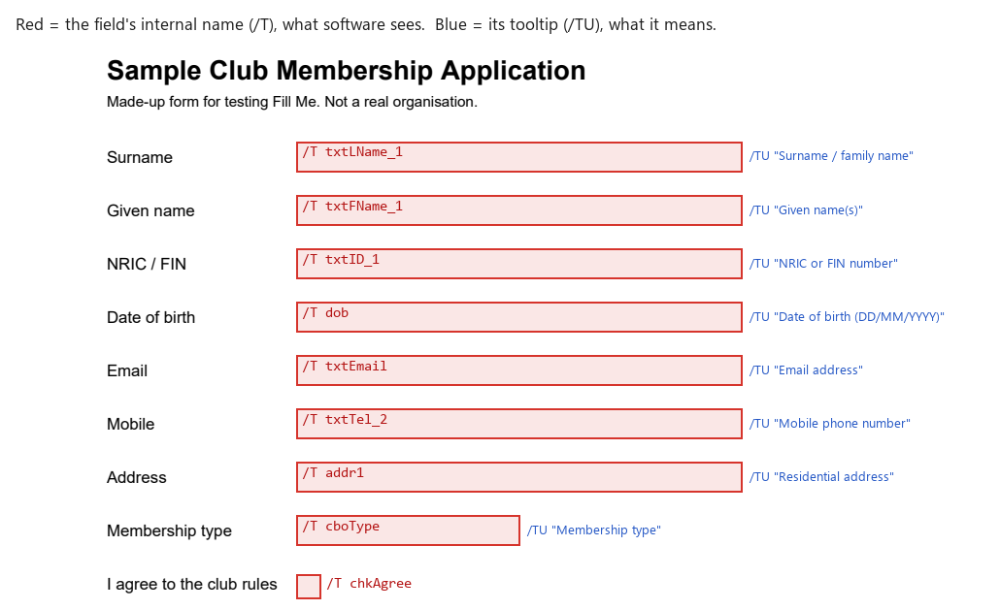
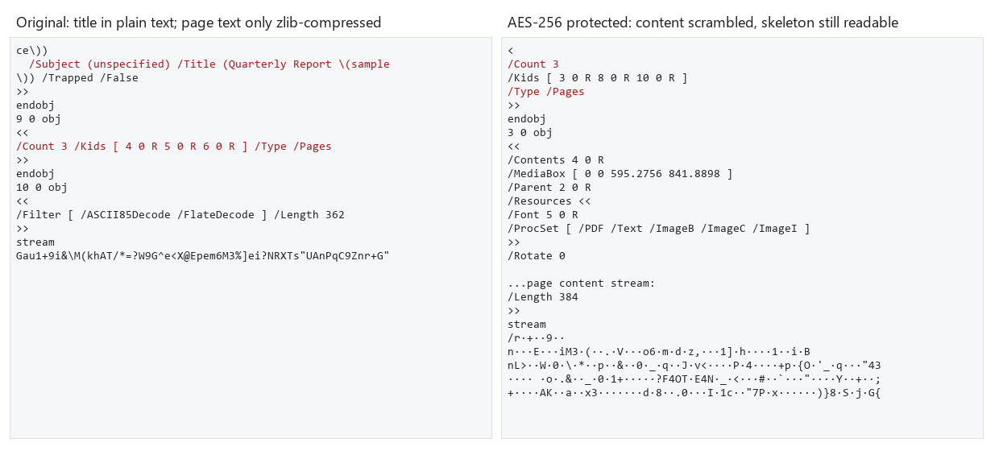
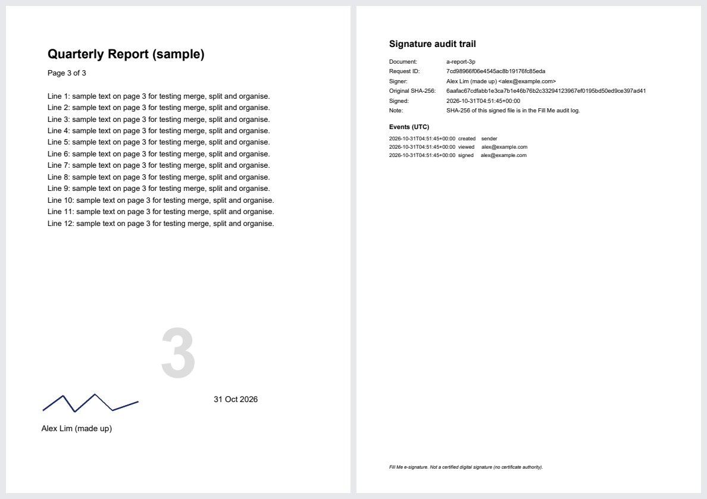

# What we uncovered: how a PDF stores pages and forms, and what a password really protects

Person A, SPEC section 4. Everything here comes from opening our sample files with pypdf. Reproduce it with `python docs/findings/a_measure.py` and `python docs/findings/a_figures.py` (output in [`a-numbers-raw.txt`](a-numbers-raw.txt)).

## 1. Pages are a tree of objects, not a list

A PDF is a set of numbered objects. The file's **catalog** (`/Root`) points to a **page tree**:

```
Catalog keys: ['/PageMode', '/Pages', '/Type']
Pages node:   {'/Type': '/Pages', '/Count': 3, '/Kids': [4 0 R, 5 0 R, 6 0 R]}
Page 1 keys:  ['/Contents', '/MediaBox', '/Parent', '/Resources', '/Rotate', '/Trans', '/Type']
```

- `/Kids` holds references (`4 0 R` means "object 4"), so the pages themselves live elsewhere in the file.
- Each page carries its own `/MediaBox` (size), `/Resources` (fonts and images) and `/Contents` (drawing commands).

**Why that makes Acrobat's "organize" tools cheap:**

- *Merge, split, reorder and delete* only rewrite `/Kids` and copy the referenced objects. Nothing is re-rendered, which is why merging 53 pages takes about 11 ms.
- *Rotate* only sets a page's `/Rotate` number (0/90/180/270). The page content is untouched.

## 2. Form fields have two names: one for machines, one for people

Form fields hang off the catalog in `/AcroForm → /Fields`. Each field is an object with:

| Key | Meaning | Example from our sample |
|---|---|---|
| `/T` | internal name, what software sees | `txtLName_1` |
| `/TU` | tooltip, the human meaning | `Surname / family name` |
| `/FT` | type: `/Tx` text, `/Btn` checkbox/radio, `/Ch` choice, `/Sig` signature | `/Tx` |
| `/Rect` | where the box sits on the page, in points from the bottom-left | `[200, 700, 500, 720]` |
| `/V` | the current value | (empty until filled) |



All nine fields of `samples/a-form-fields.pdf`:

```
/T txtLName_1   /FT /Tx   /TU Surname / family name
/T txtFName_1   /FT /Tx   /TU Given name(s)
/T txtID_1      /FT /Tx   /TU NRIC or FIN number
/T dob          /FT /Tx   /TU Date of birth (DD/MM/YYYY)
/T txtEmail     /FT /Tx   /TU Email address
/T txtTel_2     /FT /Tx   /TU Mobile phone number
/T addr1        /FT /Tx   /TU Residential address
/T cboType      /FT /Ch   /TU Membership type
/T chkAgree     /FT /Btn  /TU Agree to the rules
```

**What this means for Fill Me:**

- The gap between `/T` (`txtLName_1`) and `/TU` ("Surname") is why browser autofill can't fill PDFs. It is also what Person C's smart autofill bridges: the model only ever sees these names, never your values.
- A checkbox isn't "true". It holds the *name* of its "on" appearance (`/Yes` here, but some forms use `/On` or `/1`). `fill_sign` reads that name from the widget's `/AP` dictionary instead of guessing.
- A value alone doesn't change what's drawn on the page. Viewers draw the field's *appearance stream*. That's why we set `/NeedAppearances true`, and why "flatten" draws the value into the page and then removes the live field.

## 3. What "password-protected" actually encrypts

We protected the sample with AES-256 (`protect` tool) and looked at the raw bytes:



| Check | Original | Protected |
|---|---|---|
| Document title (`/Title (Quarterly Report…)`) readable in the raw bytes | **yes**, plain text | **no** |
| Page text | zlib-compressed: one standard `decompress` call gives `(Quarterly Report \(sample\)) Tj` | **no**, AES-encrypted |
| Opens in pypdf without the password | yes | **no** |
| Opens in PDFium (Chrome's PDF engine) without the password | yes | **no** ("Incorrect password") |
| `/Type /Pages`, `/Count 3`, `/MediaBox` readable in the raw bytes | yes | **yes, still plain text** |

The `/Encrypt` dictionary we write is `/Filter /Standard /V 5 /R 6 /Length 256`, which is AES-256 as defined in PDF 2.0.

**What's going on:**

- **A normal PDF only looks scrambled.** Its page text is compressed, not hidden, and the title and author sit in plain text.
- **Only strings and streams are encrypted:** the page content, text, images, the title, and field values. The **object skeleton** stays readable, so anyone can see how many pages a protected file has, their sizes, and that it has form fields, without the password.
- **The "open" password (user password) is real cryptography.** Without it the content is unreadable.
- **The permission flags are not.** "No copying" and "no printing" are bits in the `/P` integer (ours, for print + comments only: `0b1111…1111_1001_1110_0111`, where bit 5 = copy is 0). Any program that has the open password can decrypt everything and simply ignore them. pypdf extracted the text of our "copy not allowed" file in one line. Permissions are a polite request to well-behaved viewers, not protection.

**The honest message for users** (and our protect screen says so): rely on the password, not on the permissions.

## 4. What our e-signature is (and isn't)



**What Fill Me's e-sign does:**

- Draws the signature, name and date into the page content.
- Appends an audit page: who signed, when, and the SHA-256 hash of the original file.
- Keeps the full event log (created, viewed, signed, completed) in `storage/esign.db`.
- Refuses to sign if the original file changed after the request was sent, because its hash no longer matches.

**What it is not:** a certified digital signature. Acrobat's paid "certified" signatures embed a `/Sig` field holding a cryptographic signature from a certificate authority. We don't have one, and we say so on the signing page and on the audit page.

## 5. Coordinates: PDF counts from the bottom-left

PDF points run from the **bottom-left** corner (72 points per inch). Browsers count pixels from the **top-left**.

Our tools take positions from the browser as **fractions of the page**, top-left origin (`{page, x, y, w, h}` between 0 and 1), and `app/core/stamp.py` converts them using the page's `/CropBox`. Pages with a `/Rotate` value have the rotation baked into their content first, so a signature lands where the user clicked, whatever the page size or orientation.
